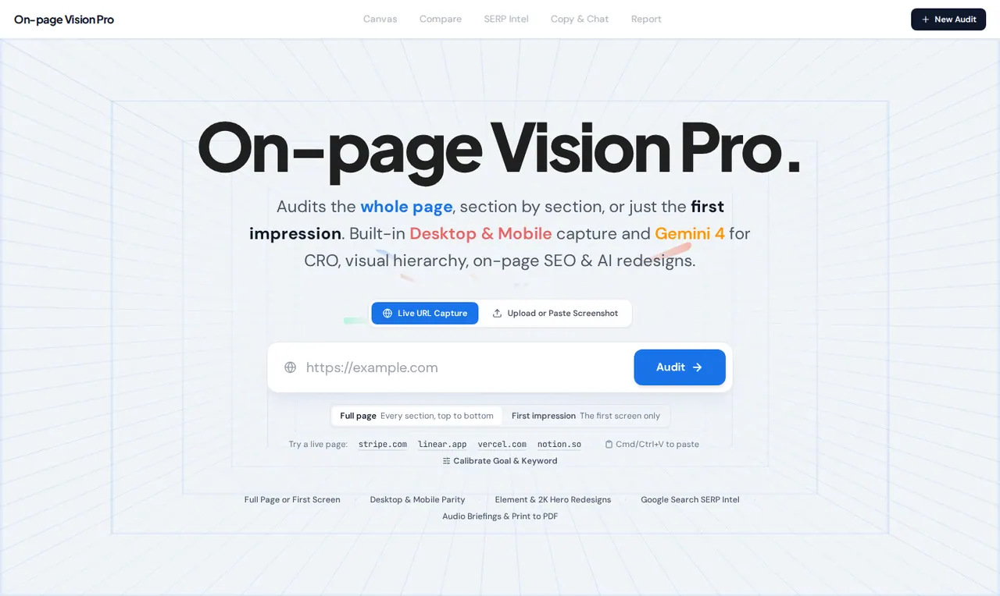
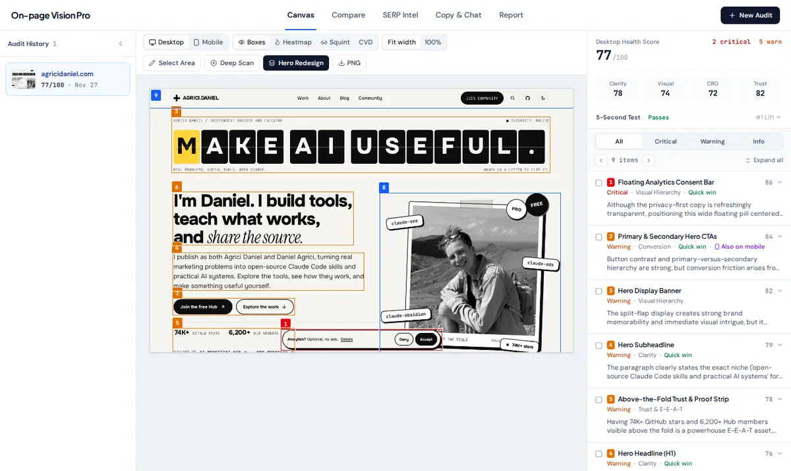
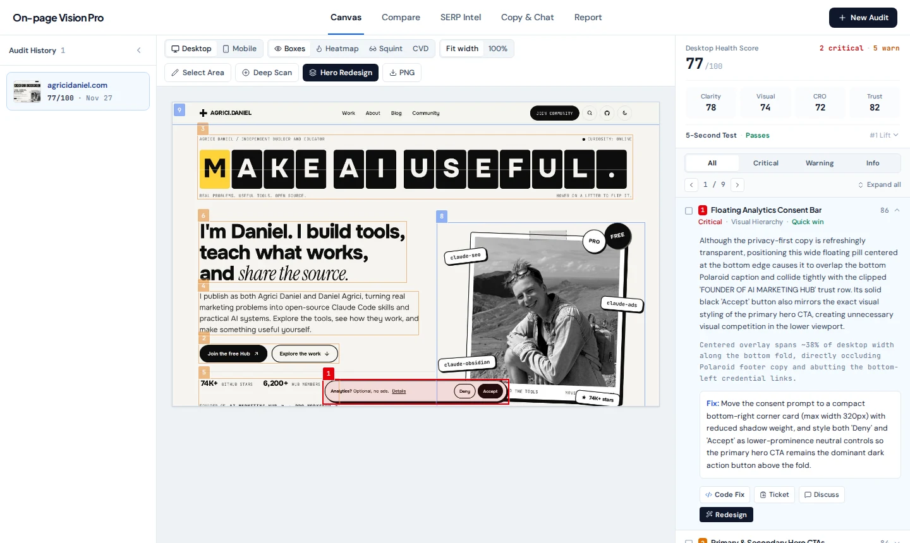
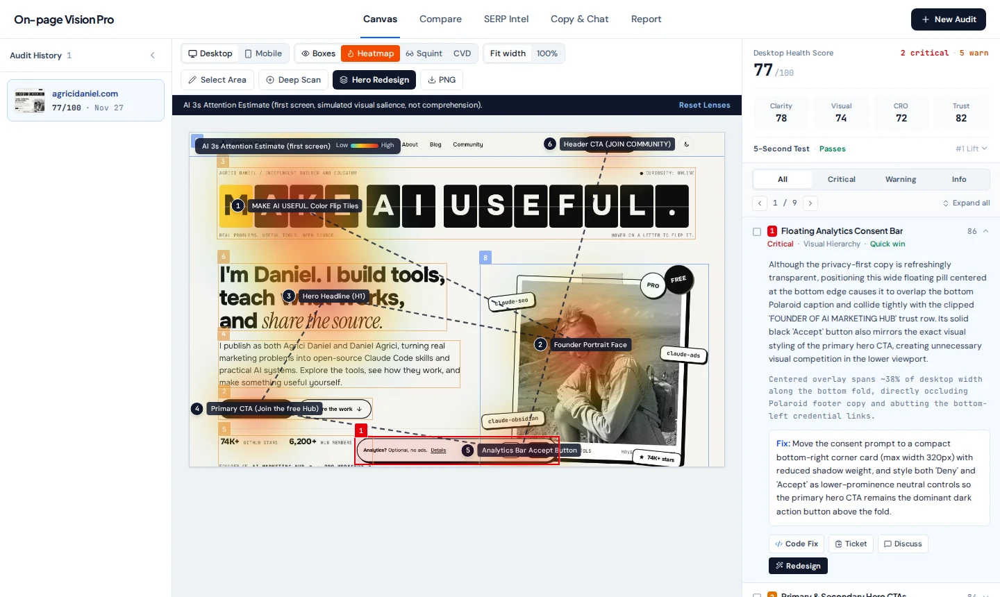
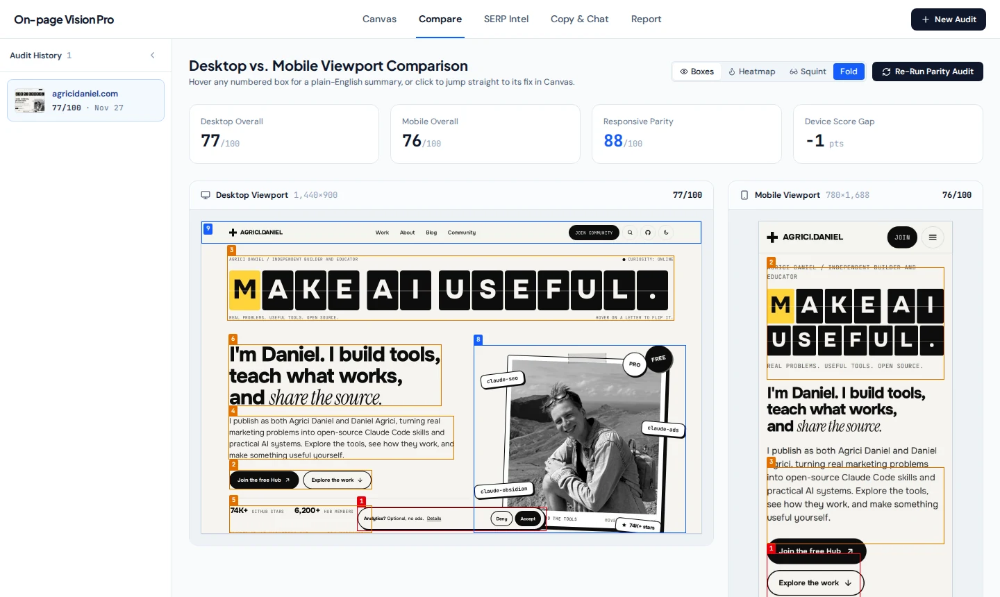
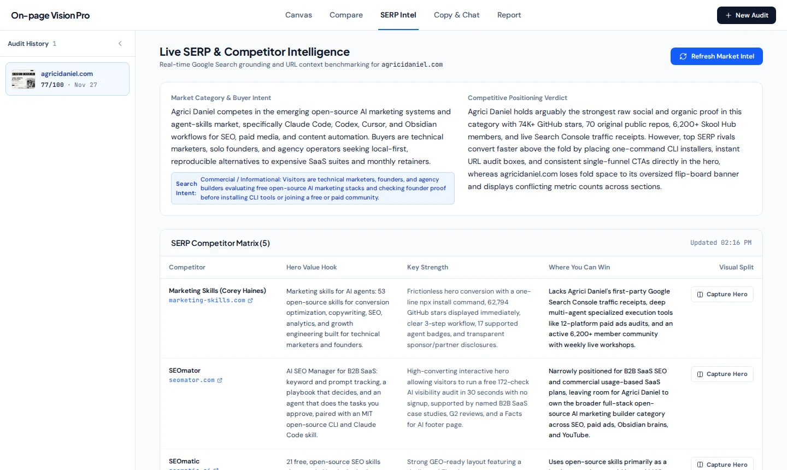
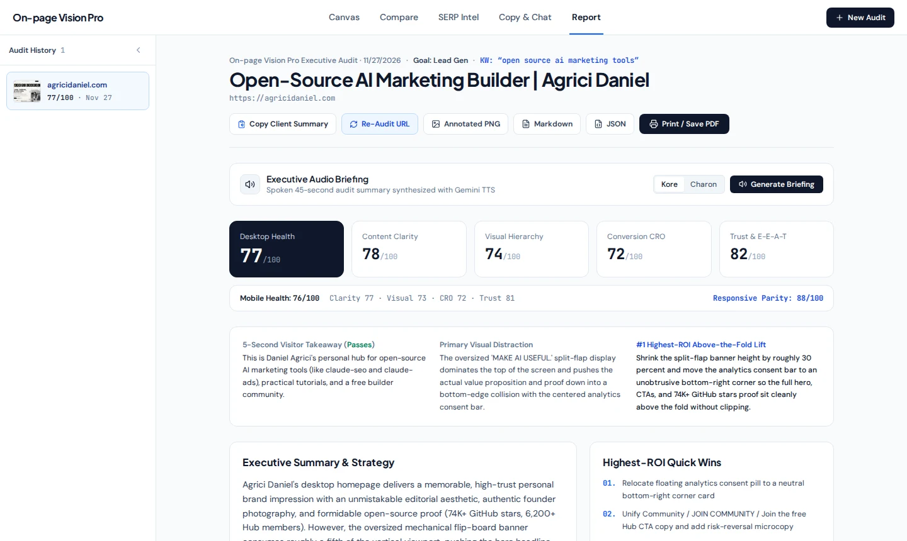
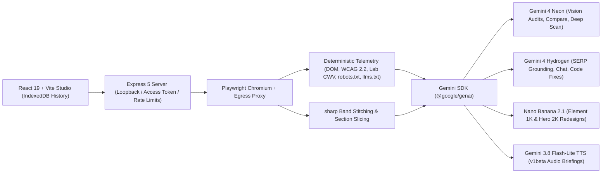

<div align="center">

# On-page Vision Pro

**Full-page CRO, visual hierarchy, accessibility, and on-page SEO/GEO audit studio.**
Built with Express, React 19, Vite, Tailwind CSS 4, Playwright Chromium, `sharp`, and Gemini 4 + Nano Banana 2.1.


<br />



</div>

---

## Why On-page Vision Pro

Most page audit tools either dump generic SEO checklists without seeing the rendered layout or ask a vision model to guess technical metrics from a screenshot alone.

**On-page Vision Pro** combines both sides in one local-first studio:

1. **Deterministic browser telemetry first:** Playwright captures Desktop (`1440px`) and Mobile (`390px @ 2x`) screenshots while measuring real hydrated DOM, WCAG 2.2 AA contrast and tap targets, broken images, JSON-LD syntax, HTML landmarks, Lab Core Web Vitals (`TTFB`, `FCP`, `LCP`, `CLS`), `/robots.txt` AI crawler policies, `/llms.txt`, and HTTP security headers (`HSTS`, `CSP`, `X-Robots-Tag`).
2. **Section-by-section multimodal vision:** Tall pages are sliced server-side with `sharp` into overlapping high-resolution bands, audited in parallel by **Gemini 4 Neon** with exact pixel bounding boxes, deduplicated across seams, and ranked by a page-level overview pass.
3. **Closed-loop execution:** Jump directly from any finding to ready-to-paste code patches, **Nano Banana 2.1** visual element and 2K hero redesigns (including `9:16` mobile crops), live Google Search **SERP & GEO competitor intelligence**, A/B copy variants, streaming **CRO Strategist Chat**, spoken **Executive Audio Briefings**, and print-ready PDF/Markdown/JSON reports.

---

## Interactive Walkthrough

Click through findings with pixel-exact overlays, inspect simulated 3-second attention salience, compare Desktop vs. Mobile parity, benchmark live Google Search rivals, and export an executive report with deterministic telemetry:

<div align="center">



*Full workflow: Canvas Inspector -> AI 3s Attention Heatmap -> Mobile View -> Desktop vs. Mobile Parity -> Live SERP Intel -> Executive Report.*

</div>

---

## Five Workspaces in Detail

### 1. Visual Canvas & Finding Inspector

Every finding is anchored to its exact pixel coordinates on the rendered screenshot, color-coded by severity (`Critical`, `Warning`, `Info`), linked to its matching issue on the other device (`Same issue on mobile`), and paired with 1-click **Code Fix**, **Jira/Linear Ticket**, **Section-Aware Deep Scan**, **Manual Region Audit**, and **Nano Banana 2.1 Element & Hero Redesigns**.



### 2. AI 3s Attention Heatmap, Squint & Color-Blind Lenses

Inspect above-the-fold visual salience with a clearly labeled **AI 3s Attention Estimate (first screen)** scanpath, plus blur-based **Squint** hierarchy checks and **CVD** (Protanopia, Deuteranopia, Tritanopia, Achromatopsia) accessibility lenses. Heatmap overlays are opt-in when exporting annotated PNGs and never fabricate fake hotspots if model hotspots are absent.



### 3. Desktop vs. Mobile Responsive Parity

Inspect Desktop (`1440x900` or full page) and Mobile (`390x844 @ 2x` or full page) side by side with a fold boundary line, responsive parity score, device score gap, cross-device issue links, and mobile-specific touch-target findings.



### 4. Live SERP, Competitor & AI Overview (GEO) Intelligence

Uses **Gemini 4 Hydrogen** with live **Google Search grounding** and **URL Context** to classify primary search intent, surface 3 to 5 live SERP competitors with side-by-side **Capture Hero** visual splits, uncover keyword, E-E-A-T, and **AI Overview / GEO citability gaps**, and display the exact executed search queries and grounding sources. Deterministic page telemetry (`llms.txt`, `robots.txt`, canonical, JSON-LD types) is injected as ground truth so SERP analysis stays aligned with the real site.



### 5. Executive Report, Audio Briefings & Export Suite

Combines dual Desktop + Mobile scorecards, the 5-Second Test verdict, Highest-ROI Quick Wins, the full **Technical SEO, WCAG 2.2, Lab CWV & GEO Telemetry** table, **Gemini 3.8 TTS** spoken executive briefings (`Kore` / `Charon` voices), and 1-click **Copy Client Summary**, **Annotated PNG**, **Markdown**, **JSON**, and clean **Print / Save PDF** exports.



> **Honest measurement scope:** The Attention Heatmap is an AI-estimated first-screen visual salience simulation (not real user eye-tracking), and Core Web Vitals (`TTFB`, `FCP`, `LCP`, `CLS`) are lab measurements captured during Playwright load before synthetic scrolling (not CrUX 28-day field data).

---

## Quick Start

### Requirements

- **Node.js `>= 22.18.0`** (runs `server.ts` natively with Node type-stripping and `--env-file-if-exists`)
- **Bun** (recommended, matches `bun.lock`) or **npm**
- **Playwright Chromium** for full-page capture (`npx playwright install chromium`; without it, capture falls back to viewport-only remote providers)
- **`sharp`** prebuilt native binaries (installed automatically) for server-side image slicing and compression

### Install & Run

```bash
# 1. Install dependencies
bun install          # or: npm install

# 2. Ensure Playwright Chromium is installed
npx playwright install chromium

# 3. Configure environment variables
cp .env.example .env.local
# Edit .env.local and add your GEMINI_API_KEY

# 4. Run in development (Express + Vite HMR on http://127.0.0.1:3000)
npm run dev
```

For production builds:

```bash
npm run build
npm start
```

Both `npm run dev` and `npm start` load `.env` followed by `.env.local` (`.env.local` overrides `.env`; shell environment variables override both). The server boots and serves `/api/health` and `/api/capture` without a key; Gemini audit, redesign, SERP, copy, chat, and audio routes require `GEMINI_API_KEY`.

> **Model access note:** Default model IDs target Gemini 4 (`gemini-4-neon`, `gemini-4-hydrogen`), Nano Banana 2.1 (`gemini-nano-banana-2.1`), and Gemini 3.8 TTS (`gemini-3.8-flash-lite-tts`). If your API key uses standard public Gemini model IDs or returns HTTP `404` for a preview model, override `GEMINI_MODEL_AUDIT`, `GEMINI_MODEL_TEXT`, `GEMINI_MODEL_IMAGE_HERO`, `GEMINI_MODEL_IMAGE_EDIT`, and `GEMINI_MODEL_TTS` in `.env.local` (see `.env.example`).

---

## Architecture & Model Stack



### Default Model Routing

Every model ID can be overridden in `.env.local`:

| Task | Default Model | Env Override | Fallback / Notes |
| :--- | :--- | :--- | :--- |
| Viewport, Full-Page, Deep Scan, Compare, Copy Variants | `gemini-4-neon` | `GEMINI_MODEL_AUDIT` | Falls back to `GEMINI_MODEL_AUDIT_FALLBACK` (`gemini-4-hydrogen`) |
| SERP Grounding, Code Fixes, Strategist Chat, Brief Script | `gemini-4-hydrogen` | `GEMINI_MODEL_TEXT` | Live `googleSearch` + `urlContext` on SERP route |
| Full-Hero Redesign (`2K`, Desktop `16:9` / Mobile `9:16`) | `gemini-nano-banana-2.1` | `GEMINI_MODEL_IMAGE_HERO` | Compressed server-side to JPEG via `sharp` |
| Element Redesign (`1K`) | `gemini-nano-banana-2.1` | `GEMINI_MODEL_IMAGE_EDIT` | Falls back to `gemini-3.1-flash-lite-image` |
| Spoken Executive Audio Briefing | `gemini-3.8-flash-lite-tts` | `GEMINI_MODEL_TTS` | Routed via `v1beta`, wrapped to playable 24 kHz WAV |

---

## Full-Page vs. First-Impression Audits

- **Full-page mode** (`/api/audit/page`, default for URL capture): captures Desktop (`1440px` wide, capped at `24,000` CSS px) and Mobile (`390px @ 2x = 780px` wide, capped at `15,000` CSS px / `30,000` image px) in stitched bands to bypass Chromium's 16,384 px texture limit, slices into up to 16 overlapping sections, runs parallel high-res audits, maps boxes back to full-page pixels, deduplicates across seams, and runs one overview pass to label sections and rank the top 3 to 5 priorities.
- **First-impression mode** (`/api/audit/viewport`): audits only the above-the-fold screen in a single Gemini call for fast, low-cost hero reviews.
- **Section-aware Deep Scan** (`/api/audit/more`): targets the currently scrolled section on tall pages in a single focused call and deduplicates in pixel space against existing findings.

### Tuning & Spend Controls

| Variable | Default | Purpose |
| :--- | :--- | :--- |
| `GEMINI_PAGE_AUDIT_THINKING` | `low` | Thinking level for full-page calls (`low`, `medium`, `high`, `xhigh`) |
| `GEMINI_PAGE_SECTION_HEIGHT_DESKTOP` | `1800` | Desktop slice height in image px (`900` to `4000`) |
| `GEMINI_PAGE_SECTION_HEIGHT_MOBILE` | `2400` | Mobile slice height in image px (`900` to `4000`) |
| `GEMINI_PAGE_AUDIT_CONCURRENCY` | `8` | Process-wide concurrent section calls (`1` to `16`) |
| `GEMINI_RATE_LIMIT_RETRIES` | `2` | Same-model retries on HTTP 429 before fallback (`0` to `5`) |
| `VP_MODEL_CALL_BUDGET` | unset | Hard per-process Gemini call cap (returns HTTP `429` past `N`; non-integer fails closed) |
| `VP_DEBUG_RAW` | off | Set to `1` to log raw model text under `.agent/results/raw-model-text/` |

**Measured timing reference (one page, 2026-11-24, not a guarantee):** on a 1,440 x 10,539 px desktop page (`agricidaniel.com`), 7 sections at 1,800 px plus 1 overview (8 calls) ran in **118 to 131 s** at `low` thinking (~53k to 54k tokens) vs. **366 to 369 s** at `medium` thinking (~70k tokens); 2,400 px sections (6 calls) ran in **78 s** (~42k tokens).

### Image & Finding Limits

- **Uploads & captures:** PNG, JPEG, or WebP verified from header magic bytes; max **24 MB decoded**, max width **2,880 px**, max height **30,000 px**, max **43.2 megapixels**.
- **Findings cap:** Full-page audits keep up to **30 findings** (`MAX_PAGE_FINDINGS = 30`), prioritizing blockers and highest severity; additional findings are preserved in `omitted_items` for on-demand expansion.
- **Capture fallback:** If Playwright fails or a page blocks headless Chromium, capture falls back to viewport-only remote providers (Microlink -> thum.io -> WordPress mShots) and records a clear warning.

---

## Security Posture

- **Loopback by default & fail-closed exposure:** Binds to `127.0.0.1:3000` by default. Setting a non-loopback `HOST` (such as `0.0.0.0` in Docker or Cloud Run) **refuses to start** without `APP_ACCESS_TOKEN` unless `ALLOW_OPEN=1` is explicitly set. When `APP_ACCESS_TOKEN` is configured, all `/api/*` routes except `/api/health` and `/api/session` require a constant-time verified Bearer token or `HttpOnly` `SameSite=Strict` session cookie.
- **In-memory rate limiting:** Per-IP fixed 1-minute windows returning HTTP `429` with `Retry-After` (`RATE_LIMIT_PER_MIN=300`, `RATE_LIMIT_MODEL_PER_MIN=20`, `RATE_LIMIT_AUTH_PER_MIN=10`).
- **SSRF & browser isolation:** Outbound fetches (`server/safeFetch.ts`) and Playwright capture (`server/egressProxy.ts`) enforce public-address DNS checks on every redirect hop and socket connect (blocking loopback, RFC 1918, link-local, metadata, and special-purpose IPv4/IPv6 ranges), funnel browser traffic through a local egress proxy (`<-loopback>`, ports 80/443 only, max 64 concurrent `CONNECT` tunnels, 16 MB / 60 s per tunnel), and disable WebRTC, WebTransport, Workers, ServiceWorkers, WebSockets, downloads, and popups.
- **Prompt-injection fencing:** Untrusted scraped titles, descriptions, headings, and URLs are isolated inside `<untrusted_page_data>` delimiters with explicit data-only system instructions.
- **Strict request & response caps:** Per-route JSON body caps (16 KB URL routes, 512 KB text routes, 34 MB single-image routes, 66 MB compare route), upstream byte caps, and hard request deadlines.

---

## Scripts & Verification

```bash
npm run dev     # Express + Vite HMR on http://127.0.0.1:3000
npm run lint    # Type-check with tsc --noEmit
npm test        # Run full unit & route test suite (257 tests via node --import tsx --test)
npm run build   # Production Vite bundle into dist/
npm start       # Production Express server (Node native type-stripping, zero tsx runtime)
```

---

## Security & License

- **Security:** See [SECURITY.md](SECURITY.md) for vulnerability reporting and security architecture details.
- **Changelog:** See [CHANGELOG.md](CHANGELOG.md) for release notes.
- **License:** Licensed under the [Apache License 2.0](LICENSE).

